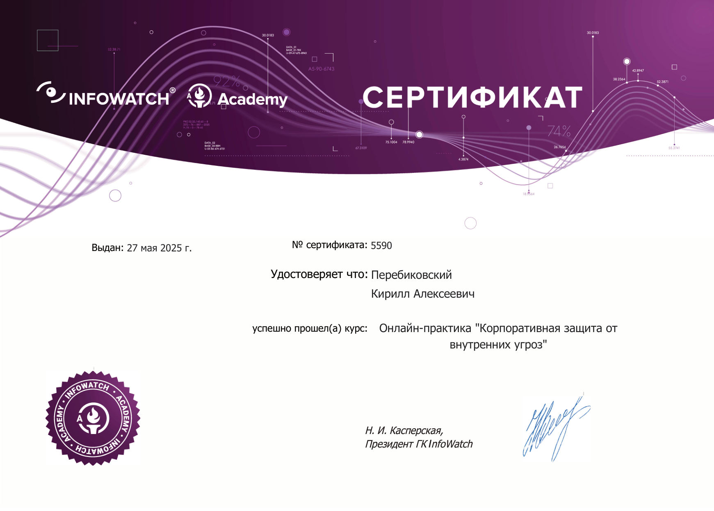
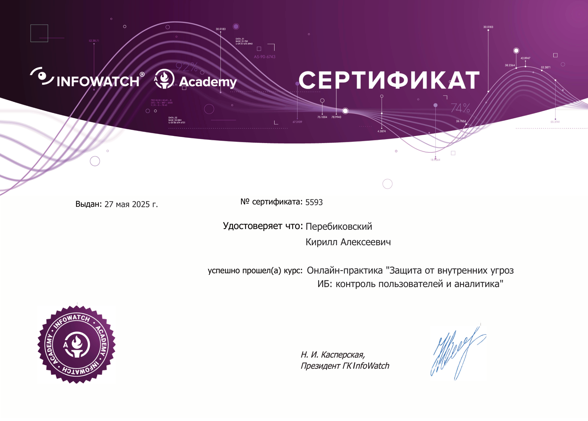
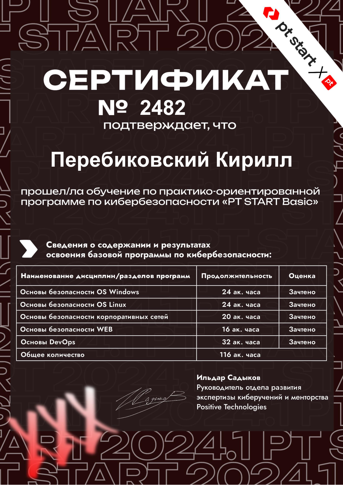
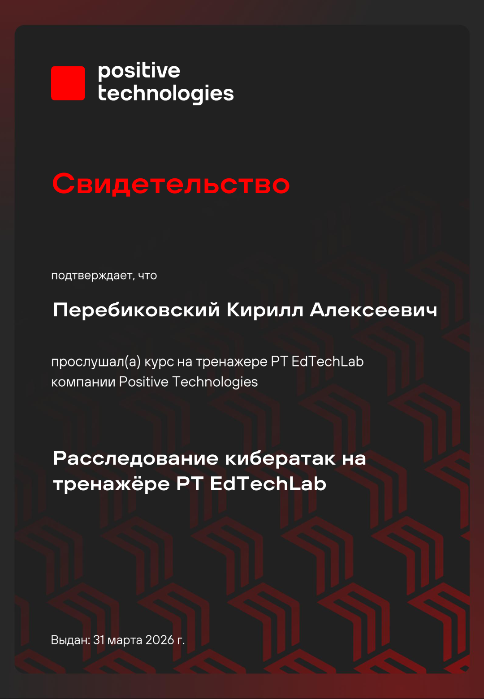

# Кирилл Перебиковский · Kirill Perebikovskii (KP)

> **Специалист по информационной безопасности & Software Developer**  
> **Cybersecurity Specialist & Software Developer**

---

### 🌐 Быстрая навигация / Quick Language Jump
[🇷🇺 **Русская версия**](#-русская-версия) | [🇬🇧 **English Version**](#-english-version)

---

## 🇷🇺 Русская версия

### 👤 Обо мне
Специализируюсь на стыке практической информационной безопасности и программной инженерии. Занимаюсь разработкой защищенных сервисов на Python, исследованием устойчивых механизмов аутентификации (WebAuthn/FIDO2) и противодействием фишингу и веб-угрозам. Имею практический опыт администрирования корпоративных DLP-систем, аудита безопасности серверов Linux, анализа уязвимостей и внедрения систем мониторинга доступности сервисов (Prometheus, Grafana). Мой подход к работе — внимание к деталям архитектуры, минимизация поверхности атаки и создание надежных, поддерживаемых решений.

---

### 💼 Опыт работы

#### **Positive Technologies**
- **Разработка инструментов автоматизации и мониторинга**: разработал и внедрил Telegram-бота для оперативного контроля состояния серверов безопасности, проверки доступности сервисов и оперативного информирования команды;
- **Анализ защищенности инфраструктуры**: проводил регулярное сканирование инфраструктуры и веб-сервисов, классификацию выявленных уязвимостей по уровню риска и контроль процессов их устранения;
- **Hardening и системная безопасность Linux**: выполнял настройку параметров безопасности серверов под управлением Linux (разграничение прав доступа, конфигурирование межсетевого экрана, централизованный сбор и аудит системных журналов);
- **Инфраструктурный мониторинг и телеметрия**: внедрил стек Prometheus + Grafana для непрерывного сбора метрик, визуализации состояния и мониторинга доступности внутренних security-сервисов;
- **Безопасность контейнеризации**: обеспечивал стандарты безопасной сборки и запуска Docker-контейнеров (минималистичные базовые образы, запуск от непривилегированного пользователя, минимизация векторов атак).

#### **InfoWatch**
- **Администрирование DLP-комплекса**: администрировал компоненты корпоративной системы предотвращения утечек данных InfoWatch (Traffic Monitor, Device Monitor, Data Discovery);
- **Анализ инцидентов и поведенческая аналитика**: проводил расследование инцидентов информационной безопасности и анализ пользовательской активности с применением Activity Monitor и предиктивной аналитики Prediction / Vision;
- **Разработка политик безопасности**: настраивал, тестировал и оптимизировал правила контентной фильтрации и политики контроля перемещения конфиденциальной информации;
- **Процессы внедрения и эксплуатации**: участвовал в организационных и технических аспектах интеграции DLP-решений в существующую корпоративную инфраструктуру.

---

### 🚀 Ключевые проекты

#### 1. [Phishing-Resistant-Auth-Prototype](https://github.com/avroQ/Phishing-Resistant-Auth-Prototype) (Прототип фишинг-устойчивой аутентификации на базе WebCrypto API и Manifest V3)
* **Направление**: Информационная безопасность / Прикладная криптография / Веб-безопасность
* **Стек технологий**: JavaScript (Node.js), WebCrypto API, Ed25519 (RFC 8032), HKDF (RFC 5869), Chrome Extension (Manifest V3), IndexedDB, SQLite (`better-sqlite3`), PostgreSQL, Docker
* **Проблема**: Классические факторы аутентификации (пароли, SMS-коды и TOTP RFC 6238) уязвимы перед современными атаками типа Adversary-in-the-Middle (AiTM) с обратными прокси (Evilginx2, Tycoon 2FA), перехватывающими сессионные токены в реальном времени из-за отсутствия криптографической привязки к каналу и origin. Аппаратный WebAuthn/FIDO2 устраняет вектор фишинга, но требует физических токенов (YubiKey и др.) и усложняет сценарии восстановления доступа, а синхронизируемые Cloud Passkeys подвержены локальным атакам подмены интерфейса (prompt spoofing / overlay attacks) и не обеспечивают неотчуждаемость ключей по стандарту NIST SP 800-63B AAL3. Проект посвящен исследованию границ безопасности и разработке программного браузерного аутентификатора, эмулирующего origin-binding стандартного WebAuthn.
* **Архитектура решения**:
  - **Клиентская часть (расширение Manifest V3)**: фоновый Service Worker выступает в роли доверенной вычислительной базы (TCB), функционируя в изолированном контексте без прямого доступа к DOM. Реализует генерацию мастер-ключей, доменно-зависимую деривацию через HKDF (HMAC-SHA-256) и формирование асимметричных цифровых подписей Ed25519 через WebCrypto API. Недоверенный Content Script в isolated world служит транспортным адаптером для DOM-событий (`domain-auth-request`), взаимодействуя с Service Worker через `chrome.runtime` API с проверкой `sender.origin`. Изолированный Popup UI предотвращает фоновые атаки криптографического оракула, требуя обязательного действия пользователя (клик «Подтвердить»). Ключи хранятся в IndexedDB как неизвлекаемые объекты `CryptoKey` (`extractable: false`).
  - **Криптографический протокол Challenge-Response**: аутентификатор подписывает каноническую структуру $M = c \parallel d_{norm} \parallel \text{"auth"} \parallel t$, криптографически связывая 256-битный серверный челлендж, нормализованный origin домена и метку времени.
  - **Серверная часть (Node.js/Express)**: эндпоинты `/register`, `/auth/init` (выдача челленджа с TTL 60с) и `/auth/verify` (проверка подписи Ed25519 и выдача JWT). Реализована поддержка двух СУБД: SQLite (`better-sqlite3`) и PostgreSQL.
* **Результаты в ИБ и верификация**:
  - Проведено формализованное моделирование угроз по методологиям STRIDE и Attack Trees (деревья атак), определены границы доверия WebCrypto в браузерном окружении;
  - 11 эмпирических сценариев тестирования подтвердили полную нейтрализацию перехвата учетных данных при AiTM-фишинге (строгий отказ при несовпадении origin);
  - Гарантированная защита от replay-атак за счет одноразовых 256-битных челленджей (ошибка 409 Conflict при попытке повторного использования);
  - Нейтрализация подделки запросов через XSS благодаря валидации `sender.origin` на уровне изолированного Service Worker и обязательному подтверждению в Popup UI;
  - Отсутствие разделяемых секретов и паролей на сервере — хранятся исключительно открытые ключи и метаданные;
  - Модульная архитектура с временем верификации подписи < 25 мс и готовностью к интеграции в SSO-сервисы.

#### 2. -ML-Web-malware-detection (Детектирование вредоносного веб-контента на основе машинного обучения)
* **Направление**: Информационная безопасность / Машинное обучение / Хакатон-проект
* **Стек технологий**: Python, Scikit-learn, XGBoost, Pandas, NumPy, BeautifulSoup, Flask/FastAPI, Docker
* **Проблема**: Сигнатурные антивирусные базы и статические правила WAF часто пропускают вредоносные скрипты с обфускацией, динамической генерацией полезной нагрузки или использованием легитимных функций JavaScript (eval, DOM-манипуляции). В рамках хакатона требовалось создать прототип системы для быстрого автоматического выявления вредоносного кода в веб-трафике с высокой точностью.
* **Архитектура решения**: Конвейер обработки включает модуль извлечения признаков (энтропия строк, частотные n-граммы токенов, количество и глубина специфических вызовов JS API, структурные метрики DOM) и модуль инференса на основе ансамблевых моделей градиентного бустинга и случайных лесов. Решение оформлено в виде микросервиса, принимающего веб-страницы и JS-скрипты на вход и возвращающего оценку степени угрозы с интерпретацией ключевых индикаторов.
* **Результаты в ИБ и разработке**:
  - Успешная разработка и валидация модели в условиях ограниченного времени хакатона;
  - Высокие показатели точности (Precision/Recall > 0.93) на тестовых наборах реального обфусцированного веб-вредоносного ПО;
  - Скорость оценки подозрительного скрипта менее 100 мс, что позволяет использовать сервис для предварительной фильтрации трафика;
  - Интерпретируемость детекта: сервис возвращает конкретные признаки и фрагменты кода, вызвавшие срабатывание.

#### 3. Monitoring-Bot (Бот оперативного мониторинга серверов безопасности)
* **Направление**: DevSecOps / Системное администрирование / Автоматизация
* **Стек технологий**: Python, aiogram / asyncio, Linux system APIs (psutil, systemd), Docker, SQLite
* **Проблема**: Администраторам безопасности и инженерам инфраструктуры необходим быстрый канал получения критических уведомлений о сбоях в работе серверов и защитных служб без необходимости постоянного открытия тяжелых веб-дашбордов или прямого SSH-доступа с мобильных устройств.
* **Архитектура решения**: Асинхронный Telegram-бот, взаимодействующий с локальными демонами и системными интерфейсами Linux. Сервис отслеживает нагрузку на вычислительные ресурсы (CPU, RAM, состояние дисковых накопителей), статус критических демонов (systemd services), доступность сетевых портов и целостность правил брандмауэра. Реализована строгая модель контроля доступа (авторизация по белому списку Telegram ID), шифрование локальных данных и санитаризация команд для предотвращения инъекций.
* **Результаты в ИБ и разработке**:
  - Мгновенное оповещение дежурного специалиста (задержка доставки алерта < 2 секунд);
  - Безопасный интерфейс для выполнения регламентных операций (перезапуск упавших служб, сбор свежих логов инцидентов) без открытия прямого SSH-доступа во внешнюю сеть;
  - Минимальное потребление ресурсов на хосте (< 40 МБ RAM), отсутствие влияния на целевые процессы безопасности;
  - Стабильная непрерывная работа в изолированном Docker-контейнере.

---

### 📦 Дополнительные проекты

* **[crispy-doodle](https://github.com/avroQ/crispy-doodle)** (Защита от XSS на PHP): учебный проект, демонстрирующий реализацию механизмов защиты веб-приложений от межсайтового скриптинга (XSS) — контекстное экранирование вывода, валидация входящих данных и настройка заголовков Content Security Policy (CSP).
* **[Weather app](https://github.com/avroQ/Weather-app)** (TypeScript, Vite, Docker): веб-приложение прогноза погоды с интеграцией внешних REST API, асинхронной обработкой запросов и контейнеризацией.
* **[Affine-Cipher](https://github.com/avroQ/Affine-Cipher)** (JavaScript / Node.js): программная реализация и криптоанализ классического аффинного шифра подстановки с применением модульной арифметики и частотного анализа текста.

---

### 🎓 Образование

* **НИУ ВШЭ (МИЭМ им. А. Н. Тихонова, Москва)**
  * **Квалификация**: Магистратура
  * **Направление**: Кибербезопасность
  * **Профиль**: Практический анализ защищенности, криптографические протоколы, безопасность информационных систем.
* **ПГНИУ (Механико-математический факультет, Пермь)**
  * **Квалификация**: Магистратура
  * **Направление**: Информационные системы и технологии
  * **Профиль**: Программная инженерия, архитектура информационных систем, анализ данных.

---

### 📜 Сертификаты

<table>
  <tr>
    <td width="50%" align="center">
      
       
      <strong>InfoWatch: Корпоративная защита от внутренних угроз</strong>
       
      <em>Комплексное администрирование DLP-систем и защита данных</em>
       
      <a href="./certificates/InfoWatch_Corporate_Internal_Threat_Defense.pdf">📄 Открыть PDF-сертификат</a>
    </td>
    <td width="50%" align="center">
      
       
      <strong>InfoWatch: Защита от внутренних угроз ИБ и аналитика</strong>
       
      <em>Мониторинг активности, поведенческий анализ (UBA) и расследование инцидентов</em>
       
      <a href="./certificates/InfoWatch_Internal_Threat_Protection_and_Analytics.pdf">📄 Открыть PDF-сертификат</a>
    </td>
  </tr>
  <tr>
    <td width="50%" align="center">
      
       
      <strong>Positive Technologies: PT START</strong>
       
      <em>Специализированная программа практической кибербезопасности</em>
       
      <a href="./certificates/Positive_Technologies_PT_START.pdf">📄 Открыть PDF-сертификат</a>
    </td>
    <td width="50%" align="center">
      
       
      <strong>Positive Technologies: EdTechLab</strong>
       
      <em>Защита инфраструктуры, практическая безопасность и анализ уязвимостей</em>
       
      <a href="./certificates/Positive_Technologies_EdTechLab.pdf">📄 Открыть PDF-сертификат</a>
    </td>
  </tr>
</table>

---

### 🛠 Навыки и стек технологий

* **Информационная безопасность**:
  - Администрирование DLP-систем (InfoWatch Traffic Monitor, Device Monitor, Data Discovery, Activity Monitor, Vision/Prediction — контроль каналов, мониторинг инцидентов, настройка политик)
  - Hardening Linux (настройка брандмауэра iptables/nftables, разграничение прав доступа sudo/PAM, аудит системных журналов)
  - Современная аутентификация: протоколы WebAuthn, FIDO2, криптографическая привязка к источнику (Origin-binding), защита от AiTM-фишинга
  - Анализ защищенности, сканирование уязвимостей, базовый аудит безопасности веб-сервисов (OWASP Top 10)
* **Инфраструктура, контейнеризация & DevOps**:
  - Docker (контейнеризация сервисов, безопасные образы, запуск от non-root пользователей, multi-stage сборка)
  - Kubernetes (оркестрация микросервисов, конфигурирование Deployments, StatefulSets, Services, Ingress, ConfigMaps/Secrets, сетевые политики и управление ресурсами)
  - GitLab CI/CD (настройка пайплайнов автоматической сборки, линтинга и тестирования)
  - Linux (системное администрирование, Debian, Ubuntu, Bash-скриптинг, управление сервисами systemd)
  - Мониторинг и наблюдаемость: стек Prometheus + Grafana (сбор метрик, настройка дашбордов, алертинг)
* **Разработка ПО (Software Engineering)**:
  - Python (FastAPI, Flask, asyncio, aiogram, requests, psutil)
  - Базовая веб-разработка (JavaScript, PHP, семантический HTML5, CSS3)
  - Реляционные базы данных: PostgreSQL, SQLite
  - Проектирование REST API и микросервисной архитектуры
  - Контроль версий: Git, GitHub
* **Прикладное машинное обучение (базовый уровень в задачах ИБ)**:
  - Прикладное применение ML в ИБ (классификация веб-угроз, фишинговых страниц и подозрительных URL)
  - Базовые модели классификации (Scikit-learn, LightGBM, ансамбли)
  - Предобработка и анализ данных (Pandas, NumPy, извлечение признаков, TF-IDF)
  - Метрики оценки качества моделей (Precision, Recall, ROC-AUC)

---

### 📬 Контакты

* **GitHub**: [KP](https://github.com/avroQ)
* **Telegram**: [@same33322](https://t.me/same33322)
* **Email**: [kp.godbless@gmail.com](mailto:kp.godbless@gmail.com)

---

## 🇬🇧 English Version

### 👤 About Me
I specialize at the intersection of practical information security and software engineering. My work focuses on building secure Python services, exploring phishing-resistant authentication mechanisms (WebAuthn/FIDO2), and analyzing web threats and malware. I have hands-on experience administering enterprise DLP systems, hardening Linux servers, performing vulnerability assessments, and implementing telemetry and alerting stacks (Prometheus, Grafana). My engineering philosophy centers on defensive architecture, minimizing attack surfaces, and delivering robust, maintainable systems.

---

### 💼 Work Experience

#### **Positive Technologies**
- **Security Automation & Monitoring Tooling**: Developed and maintained a Telegram bot for operational health monitoring of security servers and real-time incident alerting;
- **Vulnerability Management & Infrastructure Assessment**: Performed infrastructure and web application security scanning, vulnerability classification, risk assessment, and tracked remediation workflows;
- **Linux Security Hardening**: Configured security baselines across Linux server environments (role-based access controls, firewall policies, centralized system logging, and audit tracking);
- **Telemetry & Observability Stack**: Implemented and configured Prometheus and Grafana for metrics collection, service availability dashboards, and proactive alerting on internal security infrastructure;
- **Container Security**: Enforced secure Docker build and runtime practices (non-root execution, minimal base images, reduced attack surface).

#### **InfoWatch**
- **DLP Systems Administration**: Managed enterprise Data Loss Prevention components within the InfoWatch ecosystem (Traffic Monitor, Device Monitor, Data Discovery);
- **Security Incident Investigation & Behavioral Analytics**: Analyzed information security incidents and monitored user activity patterns using Activity Monitor and predictive analytics modules (Prediction / Vision);
- **Security Policy Engineering**: Formulated, tested, and fine-tuned content filtering rules, sensitive data discovery patterns, and data transfer prevention policies;
- **DLP Deployment & Integration**: Contributed to organizational and technical deployment workflows for integrating enterprise DLP solutions into corporate infrastructure.

---

### 🚀 Key Projects

#### 1. [Phishing-Resistant-Auth-Prototype](https://github.com/avroQ/Phishing-Resistant-Auth-Prototype) (Phishing-Resistant Authentication Prototype via WebCrypto API &amp; Manifest V3)
* **Focus**: Cybersecurity / Applied Cryptography / Web Security Engineering
* **Tech Stack**: JavaScript (Node.js), WebCrypto API, Ed25519 (RFC 8032), HKDF (RFC 5869), Chrome Extension (Manifest V3), IndexedDB, SQLite (`better-sqlite3`), PostgreSQL, Docker
* **Problem**: Traditional authentication factors (passwords, SMS codes, and TOTP RFC 6238) are fundamentally vulnerable to real-time Adversary-in-the-Middle (AiTM) reverse-proxy phishing (e.g., Evilginx2, Tycoon 2FA) due to the lack of origin-bound and channel-bound cryptographic ties. Hardware-backed WebAuthn/FIDO2 eliminates phishing vectors but introduces deployment friction and account recovery complexities, while synced Cloud Passkeys remain vulnerable to local prompt spoofing/overlay attacks and fail NIST SP 800-63B AAL3 non-exportability. This project addressed the design, security boundary analysis, and empirical verification of a software-based authenticator emulating WebAuthn origin-binding via the browser's WebCrypto API.
* **Architecture**:
  - **Client Architecture (Chrome Extension Manifest V3)**: The background Service Worker acts as the isolated Trusted Computing Base (TCB) running in a separate thread without DOM access. It handles master key generation, domain-bound key derivation via HKDF (RFC 5869, HMAC-SHA-256), and asymmetric signing via Ed25519 (RFC 8032) using WebCrypto API. An untrusted Content Script in an isolated world bridges DOM custom events (`domain-auth-request`) via `chrome.runtime` messaging with strict `sender.origin` validation. An isolated Popup UI enforces user confirmation, effectively neutralizing silent background cryptographic oracle attacks. Keys are stored in IndexedDB as non-extractable `CryptoKey` objects (`extractable: false`).
  - **Challenge-Response Protocol**: Signs a canonical payload structure $M = c \parallel d_{norm} \parallel \text{"auth"} \parallel t$, cryptographically binding a single-use 256-bit server challenge, normalized domain origin, and timestamp.
  - **Server Architecture (Node.js/Express)**: Endpoints `/register`, `/auth/init` (single-use challenge with 60s TTL), and `/auth/verify` (Ed25519 signature verification and JWT issuance). Features dual persistence supporting SQLite (`better-sqlite3`) and PostgreSQL.
* **Security & Verification Outcomes**:
  - Conducted structured threat modeling using STRIDE and Attack Trees to establish WebCrypto trust boundaries;
  - 11 empirical attack scenarios confirmed complete neutralization of AiTM reverse-proxy credential harvesting (strict rejection on origin mismatch);
  - Robust replay attack mitigation via single-use 256-bit server-side challenges (returning 409 Conflict upon reuse);
  - XSS challenge forgery mitigated via browser-enforced `sender.origin` checks in the isolated Service Worker and explicit Popup confirmation;
  - Zero shared secrets or passwords stored on the server — only public keys and metadata are persisted;
  - High-performance architecture with signature verification latency under 25ms and pluggable dual persistence (SQLite / PostgreSQL).

#### 2. -ML-Web-malware-detection (Machine Learning Web Malware Detection)
* **Focus**: Cybersecurity / Machine Learning / Hackathon Project
* **Tech Stack**: Python, Scikit-learn, XGBoost, Pandas, NumPy, BeautifulSoup, Flask/FastAPI, Docker
* **Problem**: Traditional signature-based detection and static WAF rules often fail against obfuscated web malware, polymorphic malicious JavaScript, and zero-day payload injection. Developed as a fast-paced hackathon project, the challenge was to design and train an automated machine learning system capable of detecting malicious web content with high accuracy and low false-positive rates.
* **Architecture**: The processing pipeline features an automated feature extractor (Shannon string entropy, lexical token n-grams, suspicious JavaScript API call frequency, and structural HTML/DOM properties) coupled with an ensemble gradient boosting classifier (XGBoost/RandomForest). The inference engine is packaged into a lightweight REST microservice that evaluates incoming payloads and returns confidence scores alongside indicator breakdowns.
* **Security & Development Outcomes**:
  - Successfully built, trained, and benchmarked within strict hackathon deadlines;
  - Achieved strong classification benchmarks (Precision and Recall exceeding 0.93 on real-world obfuscated malware datasets);
  - Sub-100ms inference time per payload, making it suitable for edge gateway filtering;
  - Transparent risk reporting with granular feature contribution breakdowns for security analysts.

#### 3. Monitoring-Bot (Operational Infrastructure Security Monitoring Bot)
* **Focus**: DevSecOps / Systems Administration / Security Automation
* **Tech Stack**: Python, aiogram / asyncio, Linux system APIs (psutil, systemd), Docker, SQLite
* **Problem**: Security administrators and systems engineers require instant, reliable alert delivery and health status checks for critical servers and security services without relying on heavy web dashboards or opening direct remote SSH sessions from untrusted networks.
* **Architecture**: An asynchronous Telegram bot integrated directly with Linux system diagnostics and process managers. The service continuously monitors host resource consumption (CPU, memory, disk thresholds), systemd daemon states, security service uptimes, and firewall status. It incorporates strict security controls: hardcoded administrator whitelist verification (RBAC), sanitized command execution parsers to eliminate injection risks, and encrypted configuration storage.
* **Security & Development Outcomes**:
  - Near-instantaneous incident alerting (notification delivery latency under 2 seconds upon threshold breach);
  - Secure diagnostic interface for executing routine health tasks and retrieving log snippets without external SSH exposure;
  - Low resource footprint (< 40 MB RAM), ensuring zero performance penalty on monitored security infrastructure;
  - Containerized deployment with automated recovery and health check probes.

---

### 📦 Additional Projects

* **[crispy-doodle](https://github.com/avroQ/crispy-doodle)** (PHP XSS Defense): Hands-on implementation of defensive controls against Cross-Site Scripting (XSS) in PHP applications, featuring contextual output encoding, strict input sanitization, and Content Security Policy (CSP) headers.
* **[Weather app](https://github.com/avroQ/Weather-app)** (TypeScript, Vite, Docker): Responsive weather forecast web application built with TypeScript, Vite, and Docker, demonstrating asynchronous REST API client-server communication and containerized deployment.
* **[Affine-Cipher](https://github.com/avroQ/Affine-Cipher)** (JavaScript / Node.js): Implementation and cryptanalysis of the classical affine substitution cipher in JavaScript (Node.js), exploring modular arithmetic principles and frequency analysis.

---

### 🎓 Education

* **HSE University (Tikhonov Moscow Institute of Electronics and Mathematics — MIEM, Moscow)**
  * **Degree**: Master's Degree
  * **Major**: Cybersecurity
  * **Focus**: Applied security assessment, cryptographic protocols, information systems defense.
* **Perm State University (PSU, Faculty of Mechanics and Mathematics, Perm)**
  * **Degree**: Master's Degree
  * **Major**: Information Systems and Technologies
  * **Focus**: Software engineering, distributed systems architecture, data analysis.

---

### 📜 Certifications

<table>
  <tr>
    <td width="50%" align="center">
      
       
      <strong>InfoWatch: Corporate Internal Threat Defense</strong>
       
      <em>Comprehensive DLP administration and sensitive data protection</em>
       
      <a href="./certificates/InfoWatch_Corporate_Internal_Threat_Defense.pdf">📄 Open Vector PDF</a>
    </td>
    <td width="50%" align="center">
      
       
      <strong>InfoWatch: Internal Threat Protection & Analytics</strong>
       
      <em>User activity monitoring, behavioral analytics (UBA) & incident response</em>
       
      <a href="./certificates/InfoWatch_Internal_Threat_Protection_and_Analytics.pdf">📄 Open Vector PDF</a>
    </td>
  </tr>
  <tr>
    <td width="50%" align="center">
      
       
      <strong>Positive Technologies: PT START</strong>
       
      <em>Specialized practical cybersecurity qualification program</em>
       
      <a href="./certificates/Positive_Technologies_PT_START.pdf">📄 Open Vector PDF</a>
    </td>
    <td width="50%" align="center">
      
       
      <strong>Positive Technologies: EdTechLab</strong>
       
      <em>Infrastructure defense, hands-on security & vulnerability assessment</em>
       
      <a href="./certificates/Positive_Technologies_EdTechLab.pdf">📄 Open Vector PDF</a>
    </td>
  </tr>
</table>

---

### 🛠 Technical Skills & Tooling

* **Cybersecurity & Infrastructure Defense**:
  - Enterprise DLP Systems Administration (InfoWatch Traffic Monitor, Device Monitor, Data Discovery, Activity Monitor, Vision/Prediction — channel monitoring, incident analysis, policy tuning)
  - Linux Hardening (firewalls iptables/nftables, access controls, sudo/PAM policies, system log auditing)
  - Modern Authentication: WebAuthn, FIDO2, cryptographic Origin-binding, AiTM phishing resistance
  - Vulnerability Assessment, Security Scanning, Web Application Security Auditing (OWASP Top 10)
* **Infrastructure, Containerization & DevOps**:
  - Docker (secure containerization, non-root user execution, minimal base images, multi-stage builds)
  - Kubernetes (microservice orchestration, configuring Deployments, StatefulSets, Services, Ingress, ConfigMaps/Secrets, network security policies, and resource management)
  - GitLab CI/CD (automated build, lint, and test execution pipelines)
  - Linux Systems (system administration, Debian, Ubuntu, Bash scripting, systemd service management)
  - Observability & Monitoring: Prometheus & Grafana stack (metric telemetry, availability dashboards, alerting rules)
* **Programming & Software Engineering**:
  - Python (FastAPI, Flask, asyncio, aiogram, requests, psutil)
  - Web Fundamentals (JavaScript, PHP, semantic HTML5, CSS3)
  - Relational Databases: PostgreSQL, SQLite
  - REST API Architecture & Microservice Design
  - Version Control: Git, GitHub
* **Applied Machine Learning (Foundational in Security Tasks)**:
  - Applied ML for cybersecurity workflows (web threat detection, phishing page and malicious URL classification)
  - Foundational classification models (Scikit-learn, LightGBM, ensemble techniques)
  - Data preprocessing and analysis (Pandas, NumPy, feature extraction, TF-IDF)
  - Model quality evaluation metrics (Precision, Recall, ROC-AUC)

---

### 📬 Contacts

* **GitHub**: [KP](https://github.com/avroQ)
* **Telegram**: [@same33322](https://t.me/same33322)
* **Email**: [kp.godbless@gmail.com](mailto:kp.godbless@gmail.com)
